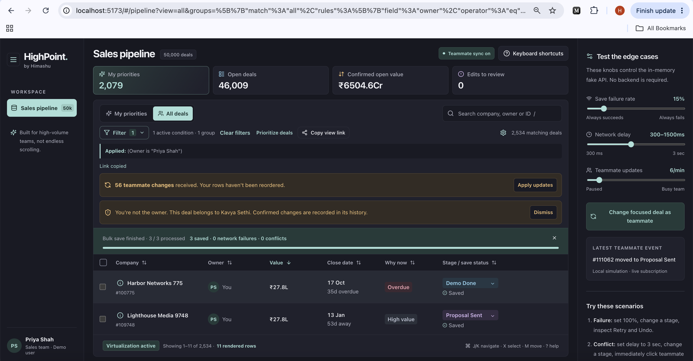

# HighPoint by Himashu — Sales Pipeline (Vue 3 + JavaScript)

A sales pipeline prototype with a table and a deal detail page for a 20-person sales team handling **50,000 deals**. Built with **Vue 3 Options API, plain JavaScript, and Vite** — no TypeScript, classes, Redux/Pinia/Vuex, login, or backend.

## Demo recording

[Watch the screen recording on Google Drive](https://drive.google.com/file/d/1b8F1ZiXjnGAqLaBqOUw4Npx-5tvBXwLj/view?usp=sharing).

## Screenshot



Filtered deal list with stable row ordering, bulk-save progress, and network simulation controls.

## Run locally

Requires **Node.js 22+** and npm. Extract the ZIP, open a terminal in `sales-pipeline-vue-js`, and run:

```bash
bash run.sh
```

The script installs dependencies and starts Vite. Open the URL printed in the terminal (typically `http://localhost:5173`). After the first install, you can also run `npm run dev`.

```bash
npm test         # Fake-API and pipeline behavior tests (no browser needed)
npm run build    # Production asset build
npm run preview  # Serve compiled assets locally
```

## Demonstrate the requirements

1. **Priorities:** Start on **My priorities** to see the signed-in demo salesperson's overdue, stale, due-soon, or high-value deals.
2. **50,000 deals:** Open **All deals** and scroll. Fixed-height virtualization renders only a small window of the data; footer shows how many DOM rows are rendered.
3. **Failed save:** Set failure rate to **100%**, change a stage, see **Not saved**, and use **Undo** or set the rate to 0% and **Retry**.
4. **Conflict:** Set delay to **3 seconds**, edit a focused deal, then click **Change focused deal as teammate**. Resolve with **Keep mine** or **Use theirs**.
   For multiple conflicts, use **Keep mine for all** or **Use theirs for all** in the error banner and confirm the affected count. This applies to all conflicted drafts, including those outside the current filter, and does not require selecting rows.
5. **Bulk:** Filter, select all matching deals, choose a stage, confirm the exact count and watch 500-item batches processed by up to 4 workers. Retry failed drafts.
6. **Stable rows:** Teammate events update record values without automatically changing order. Click **Apply updates** to re-run filters and sort.
7. **Keyboard:** J/K or arrows navigate, X/Space selects, M/Enter focuses stage, `/` focuses search, `?` opens help, Escape closes dialogs.

## Filters, sorting, and columns

- Click **Filter** to build conditions using a field, operator, and value. Use **Add group** for brackets, choose AND/OR within each group, and choose AND/OR between groups, then **Run filter**. A bracketed preview shows the exact logic. Dates match local calendar days; numeric fields compare their actual values.
- Click any data column heading to sort ascending, then click again for descending. Text uses A–Z/Z–A, numbers use numeric order, and dates use chronological order. **Prioritize deals** restores priority sorting. Sorting applies to the whole matching dataset and clears selection.
- The settings icon before the matching-deals count opens **Available** and **Visible** column lists. Double-click a column to move it between lists, or select columns and use **> / <** to show or hide them. Select one visible column and use the **up/down icons** to change its display order. Choices apply immediately and persist in browser storage when available.
- Optional columns include Deal ID, Created, Modified, Created by, Modified by, Last activity, and Revision. Created metadata stays fixed; confirmed saves and teammate events update Modified and Modified by.
- Keep the Stage column visible to use individual stage, retry, and conflict controls. Bulk stage changes remain available when that column is hidden.

For example, create an AND group containing **Stage is Contacted** and **Value > 500000**, then add another group containing **Owner is Rahul Verma**. Set **Combine groups with OR** to match `(Contacted AND value > 500000) OR Rahul`. Empty groups must be completed or removed. Existing flat-filter links retain their original AND/OR behavior.

## Deal details

Click the **info icon before a company name** to open `#/deals/<id>`. The detail page shows all deal fields, including hidden table columns. Edit Company, Owner, Value, Stage, Close date, and Last activity, then **Save changes**. IDs, audit metadata, revisions, and the derived priority reason are read-only.

Saves use the same configurable fake API and revision checks as the table. Failed drafts can be retried or discarded; conflicts compare your changed fields with current server values. **Keep mine** retries only your changed fields, preserving unrelated teammate changes. Failed drafts also remain available from the table and the bulk retry/conflict actions.

Returning to the pipeline preserves filters, selected deals, and the scroll position. Navigation asks before discarding form changes that have not been submitted. Browser refresh still resets the in-memory server.

## Ownership, history, and comments

Editing a deal owned by someone else shows **You’re not the owner** and names its owner. Shared editing remains available. Bulk confirmation shows how many selected deals belong to other people.

At the bottom of a detail page, **History & comments** shows the original assignment and each confirmed field change, including ownership transfers with previous/new owners, actor, and timestamp. Failed saves and rejected conflicts do not create completed change entries. Comments include author and timestamp, support the fake network controls, and preserve text on failure for retry. Comment drafts survive returning to the table; duplicate submissions are blocked while posting.

History is initialized lazily per deal and records actual changes during the current demo session. Refresh resets records, history, comments, and drafts; this is not a persistent backend audit system.

## Share a filtered view

The address automatically includes the selected view, search, applied filter conditions, AND/OR mode, and sorting. Use **Copy view link** or copy the address bar. Opening that URL restores the same criteria; detail URLs retain them when returning to the pipeline. **My priorities** remains a shortcut that can be narrowed further with filters.

Links share criteria, not in-memory deal edits, pending drafts, or selected rows. Recipients need access to the same app address; localhost links work only on the recipient's own machine. Column choices remain browser preferences.

## File structure

```text
src/
  App.vue                         App layout and event wiring
  constants.js                    Shared options, limits, labels, columns and API defaults
  components/
    PipelineList.vue                List assembly and explicit prop/event forwarding
    DealTable/
      index.vue                   Virtual table assembly
      components/                 Rows, cells, stage controls, header/footer, bulk controls, progress and dialogs
    DealFilters/
      index.vue                   Views, search and applied filter summary
      components/                 FilterBuilder, FilterGroup and FilterCondition
    DealDetails/
      index.vue                   Detail form state and save/navigation actions
      components/                 Form, save status, conflict comparison, system fields, history and comments
    common/
      BaseDialog.vue              Shared modal structure, focus trap and focus restoration
      RangeField.vue              Reusable labelled range input
      KeyboardHelpDialog.vue      Keyboard shortcut reference
    layout/                       Sidebar, header, metrics, notices and fake-API controls
  mixins/
    pipeline/
      index.js                    Shared state, subscriptions and cleanup
      view.js                     Filtering, sorting, selection, URLs and navigation
      saves.js                    Optimistic drafts, batch saves, retry and conflicts
      table.js                    Virtual rows, scrolling and keyboard navigation
      details.js                  Detail records, activity and comment drafts
    dialogFocus.js               Shared Options API modal focus behavior
  data/deals.js                   Seed data and deal priority rules
  services/fakeApi.js             In-memory records, history and simulated network
  utils/
    dealFields.js                Editable-field validation and form conversion
    focus.js                     Available keyboard-focus targets for dialogs
    formatters.js                Date, currency and field-value formatting
    table.js                     Column normalization, sorting and grouped filters
    viewUrl.js                   Shareable view criteria and detail URLs
  main.js                         Mounts Vue
  styles.css                      Shared styling

tests/                            API, pipeline, filters, URLs, details, history, component contracts and focus tests
WRITEUP.md / WRITEUP.pdf          Design explanation
RECORDING_SCRIPT.md               Walkthrough narration
run.sh                            One-command start
```

## Where to start reading

1. [App.vue](src/App.vue) shows how the screen is assembled and how events reach the pipeline. [PipelineList.vue](src/components/PipelineList.vue) assembles filters, notices, bulk actions and the table; state remains in App's pipeline mixin.
2. [Pipeline state](src/mixins/pipeline/index.js) declares the shared state once. The four imported Options API mixins group behavior by responsibility; they share the same component instance through `this`.
3. [DealTable](src/components/DealTable/index.vue) assembles the header, visible rows, and footer. Read [table behavior](src/mixins/pipeline/table.js) for the virtualization calculations.
4. [Save behavior](src/mixins/pipeline/saves.js) explains optimistic drafts, request tokens, revision checks, retries, and bulk workers.
5. [FilterBuilder](src/components/DealFilters/components/FilterBuilder.vue) owns draft groups; its group and condition components emit updates. Applied filters stay separate until Run filter.
6. [DealDetails](src/components/DealDetails/index.vue) owns the edit form state. Its children render the form, save/conflict feedback, system fields, and activity.

Feature-private components live beside their `index.vue`. `common/` contains shared UI behavior; `constants.js` contains configuration rather than business logic. Native controls remain native, and Vue's Options API is used throughout. No extra store or router library was added.

## Why plain JavaScript and Options API?

The assignment permits any framework and does not require TypeScript. Vue 3 supports the familiar Options API: `data()` declares state, `computed` derives values, `watch` handles search debounce and setting changes, `methods` holds actions, `mounted()` starts subscriptions, and `beforeUnmount()` cleans up. Component code accesses state through `this`, without `ref`, `.value`, or `<script setup>`.

Two Maps hold confirmed deals and optimistic drafts. `markRaw` keeps those Maps out of deep Vue reactivity; numeric version counters notify the appropriate computed values after mutations. This preserves the large-data approach while using Options API. No external state manager is needed for this one-screen prototype.

Comment drafts use a separate raw Map. Activity has its own version counter, so typing does not repeatedly clone and sort history. Confirmed metrics are cached separately from draft-status counts. Applied filter predicates are prepared once per scan, and date/time formatters are reused across row renders.

Dialogs teleport to the document body, make the background inert, lock background scrolling, and restore the previous state when closed. Focus trapping includes textareas and skips hidden or disabled controls. The main content provides a fallback when the trigger is removed or disabled. View buttons expose their pressed state; table rows/columns expose their virtual positions, and bulk progress exposes numeric progress values.

## Tradeoffs / limitations

- Browser refresh resets the in-memory fake server, and separate tabs are not actually synchronized.
- Failure is simulated *before* a batch commits. A real backend must support idempotency and ambiguous-timeout reconciliation.
- `500` records per batch, `4` concurrent workers, `84px` row height, and `9` overscan rows are sensible heuristics, not measured optima.
- Filters and sorts still process up to 50,000 records on the main thread; server-side queries become necessary at much larger sizes.
- Keyboard support is implemented, but full screen-reader compatibility and accessibility testing remain future work.
- Automated API, pipeline, component-contract and focus tests and the Vite production build pass. Component tests compile the real Vue files and use a lightweight renderer; focus tests use controlled element doubles. Browser layout, interactions and assistive-technology behavior still need manual verification.

See `WRITEUP.md` for the design rationale and alternatives.
